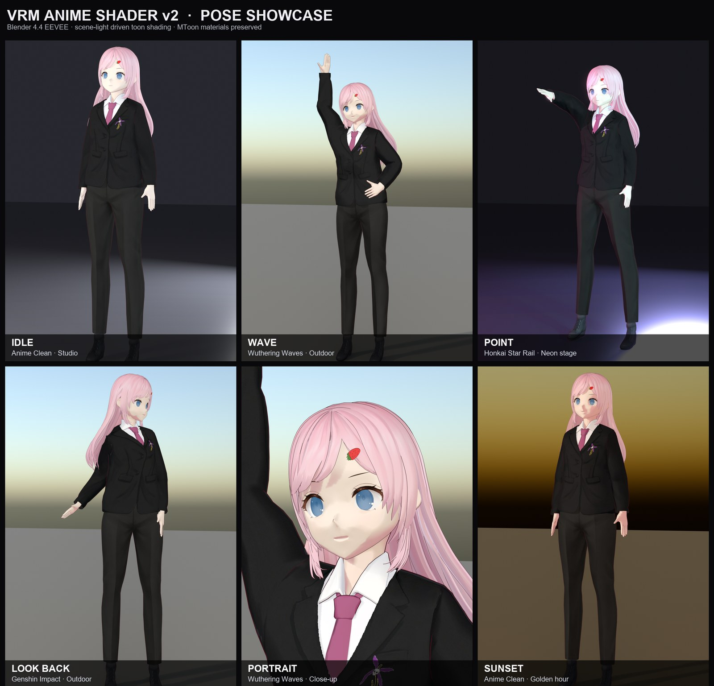
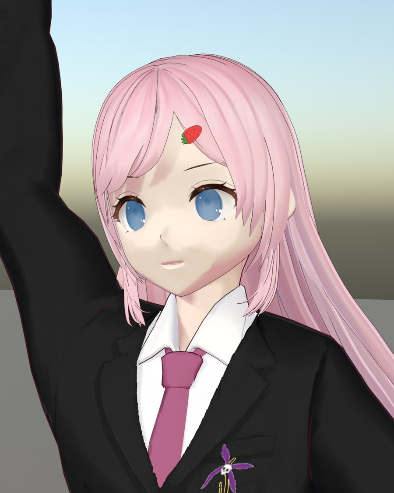
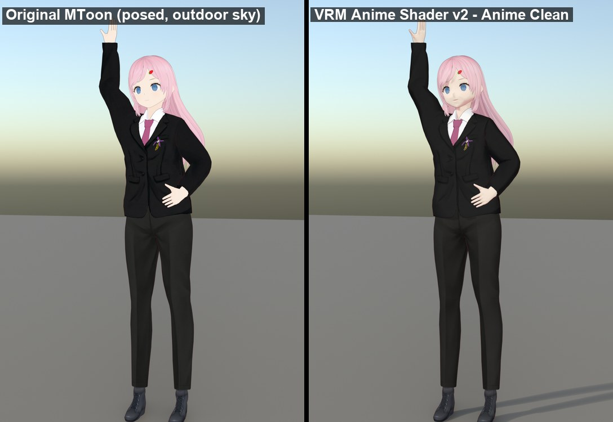

# VRM Anime Shader

Converts VRM MToon materials to a custom anime-style node group for Blender EEVEE.
Version 2 adds a **scene-light driven toon pipeline**: the converted shader samples
the actual EEVEE lighting (sun, area lights, HDRI/world, coloured lights, shadows)
instead of rendering flat unlit albedo, so the character sits inside an environment
instead of looking pasted on top of it.

## Installation

1. Clone or copy this folder to `Blender/4.4/scripts/addons/vrm_anime_shader/`
2. Enable in Blender Preferences → Add-ons → search "VRM Anime Shader"
3. Import a VRM model (requires the VRM addon), select its armature, open `Sidebar → Anime Shader`

## Usage

1. Select the VRM armature → click **Convert MToon to Anime**
2. Every non-outline MToon material on the meshes parented to the armature is
   replaced by the `VRM_AnimeShader` group. Outline geometry / outline materials
   are left untouched, so the original MToon outline pass keeps working.
3. Adjust **Shader Parameters** in the panel — changes sync to every material in real time
4. Switch between presets: *Anime Clean*, *MToon Faithful*, *Wuthering Waves*,
   *Genshin Impact*, *Honkai Star Rail*, *Flat Cel Shade*, *Soft Anime*

`MToon Faithful` reproduces the imported MToon group pixel-for-pixel (verified on
the reference model), which makes it useful as a regression baseline. The other
presets build on it and add stylised shadowing, rim light, specular and exposure.

### Presets

| Preset | Character |
|--------|-----------|
| Anime Clean | Faithful base + subtle shadow, light rim/spec, moderate scene-light response |
| MToon Faithful | Exact MToon match (no exposure/tint, no rim/spec) |
| Wuthering Waves | Cooler shadows, stronger rim, softer terminator, stronger colour response |
| Genshin Impact | Soft large shadows, light rim, neutral warm specular |
| Honkai Star Rail | Medium contrast, cool rim, purple-ish shadow tint |
| Flat Cel Shade | Hard two-tone, no rim/spec, low light response |
| Soft Anime | Wide soft terminator, gentle rim, bright ambient floor |

## Parameters

| Section | Controls |
|---------|----------|
| Shading | Threshold (light/shadow cutoff), Smoothness, MToon Shift (how strongly the material's authored Shading Shift is honoured), Tint Strength, Tint Color, Saturation, Brightness |
| Scene Light | Light Normalize (scene intensity → 0..1 compression), Ambient Floor (minimum exposure), Light Response (how much the character follows scene brightness), Light Color Tint (how much coloured light tints the character) |
| Rim Light | Color, Strength, Threshold |
| Specular | Color, Strength, Smoothness |
| Emission | Emission multiplier |

Per-material data is captured automatically during conversion: lit texture +
`baseColorFactor`, shade color + shade texture, normal map + scale, emissive
texture × factor × KHR emissive strength, MToon Shading Toony/Shift and alpha mode.

## Architecture

### Processing chain (v2)

```
Geometry normal ──► Diffuse BSDF(white) ──► ShaderToRGB ──► luma
                                                           │
                              x = luma / (luma + Light Normalize)
                                                           │
Base Color ─────────────────────────────┐        x ──► toon factor ◄── Threshold/Smoothness
Shade Color × Shade Texture ──► tint ───┤                 │            ◄── MToon Shift/Toony
                                        ├──► Lit/Shade mix ──► × light chroma ──► HSV ──┐
                                        │                                              │
Normal map ──► Glossy BSDF ──► S2RGB ──► spec mask ──► × colour/strength ──► add ────────┤
Geometry ──► Fresnel ──► rim mask ──► × colour/strength ──► add ────────────────────────┤
Emission texture × factor ──► add ──────────────────────────────────────────────────────┤
                                                                                       ▼
                                                              final Exposure × Brightness
                                                                                       │
                                                                          Emission → Alpha Mix → Output
```

Key design choices:

- **Light probe**: a white Diffuse BSDF sampled through `ShaderToRGB` gives the real
  EEVEE irradiance including shadows and world lighting. It uses the geometric normal
  so painted normal maps do not create noisy toon patches on the face.
- **Scene-independent light level**: `x = luma / (luma + k)` compresses arbitrary
  light intensities into 0..1, so one Threshold works in dim and bright scenes.
- **MToon parameters are respected**: the material's authored Shading Shift/Toony
  drive the per-material terminator, and the shade colour comes from MToon's
  `shadeColorFactor × shadeMultiplyTexture`. A model authored as "almost fully lit"
  (shift ≈ 1) stays lit; a model with shift ≈ 0 gets a proper two-tone terminator.
- **Colour integration**: the normalised light chroma tints the character by
  `Light Color Tint`, so sunset light warms the character and coloured stage lights
  tint it accordingly.
- **Exposure integration**: scene brightness maps to a final exposure multiplier
  (`Ambient Floor`, `Light Response`) so the character darkens in dark environments
  instead of glowing at full albedo.
- **Specular uses a real Glossy BSDF** sampled with `ShaderToRGB`, so highlights come
  from actual scene lights / HDRI rather than being faked.
- **Albedo gate**: additive specular/rim is scaled by base-colour luminance, so black
  cloth does not turn grey.
- **MASK alpha** is converted to a hard `alpha > cutoff` cut (dithered render method),
  BLEND stays blended. `double_sided` maps to backface culling.

### Texture tracing

The VRM importer names texture nodes by role, e.g.
`Mtoon1BaseColorTexture.Image`, `Mtoon1ShadeMultiplyTexture.Image`,
`Mtoon1NormalTexture.Image`, `Mtoon1EmissiveTexture.Image`. The converter uses those
roles instead of fragile name heuristics. Every `.image` access is wrapped in
try/except because the VRM addon can block direct reads.

## Technical Notes

### Blender 4.4 / EEVEE

- `ShaderToRGB` only exists in EEVEE. The shader is **EEVEE-only**; Cycles renders the
  converted materials black. Use EEVEE Next.
- `ShaderNodeOutputMaterial` has no Normal input; normals go through the BSDFs inside
  the node group.
- `NodeSocketVector` has no NORMAL subtype; the group's Normal input is always fed by
  a Normal Map node (flat default normal when the material has no normal texture), so
  the BSDFs never receive an invalid `(0,0,0)` normal.
- `Standard` view transform matches the VRM add-on documentation and keeps toon colours
  saturated; `AgX` can be used but desaturates the result.

### Limitations / migration

- **v2.0.0 changes the shader group interface.** Old converted materials reference the
  previous group. Re-import the VRM and convert again (or use *Rebuild Shader* before
  re-converting) after upgrading; there is no in-place migration.
- MToon **matcap** and **rim multiply** textures are not carried over (they are usually
  black/empty on VRoid exports; the custom rim light replaces them).
- **UV animation** (KHR/VRM UV scroll/rotation) is dropped; textures use the mesh UV map.
- Outline **materials/geometry are preserved**, but this addon does not create or edit
  outlines. Converted materials keep the original outline pass untouched.
- Normal maps affect specular only, not the toon terminator (intentional, cleaner anime
  shading).
- Material Preview may look brighter than Render because the studio HDRI is much
  stronger than a typical scene; use the Scene Light parameters or final Render.

## Showcase

Posed renders produced with the bundled `dev/showcase` harness (VRM 0.0 suit model,
Blender 4.4.3 EEVEE, 64 samples):



*IDLE (Anime Clean · studio), WAVE (Wuthering Waves · outdoor), POINT (Honkai Star
Rail · neon), LOOK BACK (Genshin Impact · outdoor), PORTRAIT (close-up), SUNSET
(Anime Clean · golden hour).*



Same pose and outdoor lighting, original MToon (left) vs. this addon (right):



## Verification

The addon is validated headlessly in Blender 4.4.3 against original MToon on both a VRM
0.0 and a VRM 1.0 model:

- `MToon Faithful` vs original MToon close-up: mean absolute pixel difference ≈ 0.045/255.
- Studio / sunset sky / coloured stage lights / night point lights / world-only lighting
  comparison renders confirm the new shader follows scene brightness and colour while
  keeping a cel-shaded look.
- The `dev/showcase` scripts reproduce the comparison renders and the posed showcase
  images above; see [dev/showcase/README.md](dev/showcase/README.md).

## License

MIT
